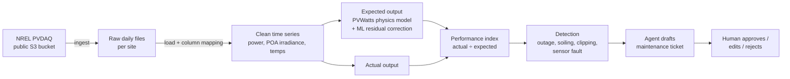

# Solar Performance Monitor

Compares each solar site's **actual** output with the output its **weather says it should have produced**, flags underperformance, and has an AI agent draft maintenance tickets for a human to approve.

Built on NREL's public [PVDAQ](https://data.openei.org/submissions/4568) dataset: real production and on-site weather sensor data from PV systems across the US.

> **Status:** Phase 1 in progress (ingestion and physics baseline). See the [roadmap](#roadmap).

## Why this problem

An operator running dozens of sites can't eyeball every inverter curve. Production naturally swings with the weather, so "output dropped 20% today" means nothing on its own. A cloudy day and a tripped inverter look the same in raw kWh. The useful question is **"is this site producing what today's sunlight and temperature say it should?"** Answering that per site, per day, at fleet scale is what this project does.

## How it works



1. **Ingest.** Download a site's files from NREL's public S3 bucket (no AWS account needed).
2. **Expected output.** NREL's PVWatts model (via [`pvlib`](https://pvlib-python.readthedocs.io/)) turns the site's own plane-of-array irradiance and module temperature into an expected AC power. A single scale factor, fit on a known-good reference window, calibrates it to that site's real-world losses. *(Phase 2 adds an ML model on the residuals to learn site-specific quirks the physics misses.)*
3. **Performance index (PI).** Daily actual energy ÷ expected energy. A healthy site sits near 1.0 regardless of weather.
4. **Detection** *(phase 2)*. Sustained PI drops get classified by their shape: a sudden drop to ~0 is an outage, a slow decline is soiling or degradation, a flat-topped curve is clipping, and erratic values point to a sensor fault.
5. **Ticket agent + approval UI** *(phase 3)*. For each flagged event, Claude drafts a maintenance ticket with the evidence. A Streamlit page lets a human approve, edit, or reject it.

## Starter fleet

| ID | Site | Location | Size | Mount | Why it's here |
|---|---|---|---|---|---|
| 2107 | Farm Solar Array | Arbuckle, CA | 893 kW | Fixed, ground | Anchor site: 7 years, 125 sensor channels, passed NREL QA cleanly |
| 4902 | NIST Ground | Gaithersburg, MD | 271 kW | Fixed, ground | Heavily instrumented research array |
| 4903 | NIST Roof | Gaithersburg, MD | 74 kW | Fixed, roof | Same weather as 4902, different mounting |
| 1430 | NREL Mesa | Golden, CO | 721 kW | Single-axis tracker | Tracker physics, high altitude |
| 1367 | Henderson Aquatic Complex | Henderson, NV | 277 kW | Fixed | Hot desert climate |

Site metadata lives in [`config/sites.yaml`](config/sites.yaml).

## Quickstart

```bash
git clone https://github.com/mam084/solar-performance-monitor.git
cd solar-performance-monitor
python -m venv .venv && source .venv/bin/activate
pip install -e ".[dev]"

# 1. See what's available, then download a site (try --dry-run first to check the size)
python -m solarmon.ingest download 2107 --dry-run
python -m solarmon.ingest download 2107 --include meter irradiance environment
python -m solarmon.ingest download 4902 --start 2016-01-01 --end 2016-12-31

# 2. See which sensors the site has and get a suggested column mapping
python -m solarmon.inspect 2107
#    -> copy the right column names into config/sites.yaml

# 3. Explore and build the baseline
jupyter notebook notebooks/01_site_eda.ipynb

# Tests run on synthetic data, so no download is needed
pytest
```

## Repo layout

```
config/sites.yaml        fleet definition and per-site sensor column mapping
src/solarmon/
  ingest.py              download from NREL's public S3 bucket
  inspect.py             list a site's sensors and suggest a column mapping
  load.py                raw files -> one clean, time-indexed frame per site
  expected.py            PVWatts physics baseline + calibration
  metrics.py             daily performance index
notebooks/               exploration, one notebook per question
tests/                   offline tests on synthetic data
```

## Roadmap

- [ ] **Phase 1: Baseline on one site**
  - [x] Repo, ingestion, and loader for both PVDAQ data layouts
  - [x] PVWatts expected-output model with calibration, plus a daily performance index
  - [ ] Download site 2107, map its columns, and validate the baseline (target: <5% nRMSE on healthy days)
- [ ] **Phase 2: Fleet + detection**
  - [ ] All 5 sites ingested and mapped
  - [ ] ML residual model (gradient boosting on weather and time features)
  - [ ] Underperformance detection and event classification, backtested on known events
- [ ] **Phase 3: Ticket agent + approval UI**
  - [ ] Claude drafts tickets from flagged events with evidence
  - [ ] Streamlit approval queue
- [ ] **Phase 4: Productionize**
  - [ ] Snowflake as the warehouse (raw → staging → marts)
  - [ ] Scheduled daily runs
  - [ ] Write-up on scaling to a full fleet

## Data

Deline, C., Perry, K., Deceglie, M., Muller, M., Sekulic, W., & Jordan, D. (2021). *Photovoltaic Data Acquisition (PVDAQ) Public Datasets* [Data set]. Open Energy Data Initiative (OEDI), NREL. https://doi.org/10.25984/1846021. Licensed CC BY 4.0.
