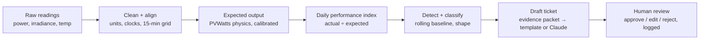

# From one site to a fleet: approach, results, and operations

This write-up covers three things: how the monitor works and why it's built that way, how well it works today, and what changes when it runs every day across hundreds of sites.

## The problem

A solar operator can't watch every site's power curve. Output swings with the weather, so a 20% drop on its own tells you nothing: a cloudy day and a tripped inverter look the same in raw kWh. The question that matters is **"is this site producing what today's sunlight and temperature say it should?"** If the answer is no, the next questions are what's wrong, how much it's costing, and who should go fix it.

## Approach

**Physics first, ML second.** Expected output comes from NREL's PVWatts model driven by each site's own plane-of-array irradiance sensor, with one calibration factor fit on a known-good year. That choice matters more than any model tuning:

- It works on day one with a year of history and no labelled faults. An ML model needs labelled faults to learn from, and most fleets have few.
- It's explainable to a technician: "the sensor saw 900 W/m² and the array made 75% of what that should give".
- It already gets within about 3% at the 15-minute level on healthy days, so an ML residual model (phase 2) will be judged against a strong baseline, not a weak one.

**Detection compares a site to itself.** A correction learned from the site's history (its normal actual/expected ratio by month and half-hour) removes biases that repeat every day. Each day's performance index is then divided by a rolling baseline: the median of the last 90 days, recomputed with flagged days left out so a long fault never becomes the new normal. Alert thresholds are scaled to the site's own day-to-day scatter, so a noisy site doesn't drown its operators in alarms.

**The shape of a loss says what caused it.** Six patterns are cheap to tell apart from daily and 15-minute data:

| Event | Signature | Why it's distinctive |
|---|---|---|
| Full outage | PI near zero | nothing else does that |
| Partial outage | abrupt step down, then flat | a fixed share of capacity went offline |
| Soiling | slow slide over weeks, reset by rain | dirt accumulates; it doesn't appear overnight |
| Curtailment | short only at midday on sunny days | an output cap only bites when output is high |
| Tracker stall | short only in the morning and evening | parked rows lose most at low sun angles |
| Sensor fault | output *above* physics, or no irradiance data | the reference, not the array, is wrong |

**The AI drafts; a person decides.** Every event gets a ticket. With an API key, Claude writes it from a fixed evidence packet (the event's numbers, dates, shape features and an O&M playbook) through a forced tool call. That design does three things:

1. **The output is always valid.** The tool schema forces every required field, so the queue never shows a half-formed ticket. Any failure falls back to a deterministic template.
2. **It can't invent readings.** The model only sees the packet, and the prompt tells it to use only those numbers and say how confident the evidence is.
3. **Nothing happens without a person.** Tickets start as `pending_review`. Approvals, edits and rejections (a rejection requires a reason) are logged with who made them and what they changed.

## Results

All numbers below are on the demo fleet. Its weather is physics-based (each site's real sun position, mounting and climate), its model error is deliberately realistic (day-to-day misses, a seasonal bias, meter noise), and its faults are injected, so the detector can be scored against the truth.

| | Result |
|---|---|
| Model error on healthy days (15-min nRMSE) | 2.6–2.9% at every site (target < 5%) |
| Faults found | 477 of 480 over 300 simulated site-years (5 sites × 30 weather seeds × 2 years) |
| Labelled correctly | 474 of 480 |
| False alarms | 4 in 300 site-years |
| Detection delay | same day for abrupt faults; ~5 weeks for soiling, with the start of the slide traced back |

Reproduce with `python -m solarmon.backtest --seeds 30 --site all`.

**What these numbers don't show yet.** Synthetic faults are cleaner than real ones. Real data brings sensor dropouts, clock errors and faults that overlap. The next milestone is running site 2107's seven years of real PVDAQ data through `preflight` and `pipeline build` and checking the events against what's visible in the record. Expect the false-alarm rate to rise and the thresholds to need tuning.

## What the real data taught us

The first automated run on site 2107's real data (Nov 2017 – Dec 2025) produced 275 events and a 17% model error. Almost all of those events were wrong, and each wrong group pointed to something the demo data hadn't exercised:

| What happened | Cause | Fix |
|---|---|---|
| 341 "sensor fault" days in 2017 | The irradiance sensor wasn't installed until November 2017 | Start each site where its irradiance data starts (`qa.trim_to_sensor_start`) |
| 152 "tracker stalls" on a fixed-tilt array | Actual/expected ran high in the morning and low in the evening every day: the sensor sees the day differently from the panels | Tracker stalls only on single-axis sites; learn the site's normal ratio by month and half-hour (`expected.shape_correction`) |
| A shape table learned from 2018 didn't fit later years | The sensor setup changed after 2018; from 2019 on, PI swings ±15% by month, the same way every year | Learn the table from all years with a robust median, so short faults don't shape it |
| Dozens of "partial outages" with PI ≈ 1.0 | The demo's daily scatter is ~2%; the real site's is ~8% | Alert thresholds scaled to each site's own scatter (`detect.site_thresholds`): 2107 alerts below ~0.80 of baseline, quiet sites keep 0.93 |
| One fault reported as seven | An unfixed problem dips in and out of the threshold | Merge same-kind events under a week apart |
| "Curtailment" on ordinary days | The midday-vs-shoulder shape test is noisy under real clouds | Curtailment needs both a flat top and a short midday, on clear days only |

After the fixes the same data gives about 40 events. Spot checks against the raw 15-minute data back them up: days with zero output in full sun, weeks-long irradiance dropouts, and a summer-2025 stretch where the site ran 8–20% short for two months.

Two honest limits remain:

- **Model error is still about 13% at 15 minutes.** A single on-site sensor and a large array see different clouds, and this site's sensor has its own quirks. Daily PI is steadier, and that's what detection uses, but a second irradiance source (satellite data or another on-site sensor) is the obvious next improvement.
- **A noisy site is a less sensitive site.** Scaling thresholds to the noise is what stops false alarms, and it also means 2107 won't flag a loss under ~20% within days. Slower losses still show up through the rolling baseline.

The demo backtest moved slightly with these changes: 477 of 480 faults found (was 480), 4 false alarms in 300 site-years (was 1), and soiling caught later. That's the price of a detector that holds up on real data.

## Scaling to a fleet

### Compute is not the bottleneck

Model and detection take about **0.08 seconds per site per two years of 15-minute data** on one CPU core. A full two-year recompute of 1,000 sites is under two minutes of compute; a daily incremental run is far less. Sites are independent, so the work parallelises with no coordination: one worker per site, or Snowpark / a task queue. The real costs are I/O and data quality, not math.

### Data layout

The warehouse (`warehouse/*.sql`) has three layers:

- **RAW**: append-only, long format (site, file, timestamp, column, value). A new sensor or a renamed column never needs a schema change, and every value traces back to its file.
- **STAGING**: one clean row per site per 15 minutes, with unit conversions, clock fixes (UTC files, fixed offsets) and inverter summing done in SQL from the same mapping as `config/sites.yaml`.
- **MARTS**: what the app and analysts read: interval and daily performance, events, tickets, pipeline runs, and an append-only `TICKET_DECISIONS` audit log that no rebuild touches.

Rough size at 1,000 sites: about 35 million rows a year in the 15-minute mart. Raw readings at 1-minute resolution are roughly 2.6 billion rows a year. That's routine for Snowflake when clustered by site and date, which these tables are.

### Daily operation

1. **Ingest** new readings per site. Today that's PVDAQ's public archive; in production, the operator's SCADA or monitoring feed. Everything after this step stays the same.
2. **Preflight** each site: mapping, file clocks, coverage, calibration. A site that fails is held back and flagged, rather than producing a misleading number.
3. **Build**: expected output, PI, events and draft tickets. Event IDs are built from site, start date and kind, and the warehouse load replaces a site's rows in one transaction, so a rerun never duplicates an event. Still to do: draft tickets only for events not seen before, and carry a decision over when an ongoing event's ID shifts because its start date was revised.
4. **Publish** to the warehouse and the app.
5. **Review**: dispatchers work the queue by priority, with ongoing issues first.
6. **Hand off** approved tickets to the work-order system (ServiceNow, Maximo, or whatever the operator uses) through its API. That integration is the only part that should ever create real work.

Steps 1–4 run today as a GitHub Actions job (`.github/workflows/update-data.yml`). It fingerprints each site's source files, config and code, and only downloads and rebuilds when one of them changed, so a quiet day costs one S3 listing per site.

### What gets harder at scale, and the plan for each

| Problem | Plan |
|---|---|
| **Onboarding hundreds of sites.** Every site names its sensors differently, and some log in UTC. | `inspect` suggests a column mapping; `preflight` names the exact config fix for each problem. Next: auto-accept a mapping when preflight passes, and send only failures to a person. |
| **Sites without an irradiance sensor.** Many small sites have none. | Swap in satellite irradiance (e.g. NREL NSRDB or a commercial feed) as the model input. Accuracy drops, so those sites get wider thresholds and their own error tracking. |
| **Alert fatigue.** A 1-in-300-site-years false-alarm rate is about 3 a year per 1,000 sites, but real data will be noisier. | Per-site thresholds learned from each site's own healthy-day error; maintenance windows that suppress alerts; merging repeat events at one site into one ticket. |
| **Learning from reviewers.** | Every rejection carries a reason. Over time those become labels: tune thresholds per fault type, and train a classifier on the shape features once a few hundred are labelled. |
| **Monitoring the monitor.** A model that drifts quietly produces confident nonsense. | `PIPELINE_RUNS` records each site's calibration and healthy-day error every run. Alert when either moves sharply. Recalibrate after known changes such as repowering or an inverter swap. |
| **LLM cost and risk.** | One call per new event, not per site per day. Events are rare, so cost is cents a day for a large fleet. The template fallback means an API outage never blocks the queue, and the human gate means a bad draft is never dispatched. |
| **Durable approvals.** The hosted demo stores decisions in a file that resets on restart. | `MARTS.TICKET_DECISIONS` in Snowflake, append-only, with the app role allowed to insert and nothing else. |

## What's next

1. Real data for site 2107: preflight, build, and compare the detected events with the record.
2. The other four sites onboarded and mapped.
3. An ML residual model on top of the physics baseline, kept only if it beats it on held-out healthy days.
4. Snowflake as the store, with approvals moved to the decisions table.
5. Ticket drafting only for events not seen before, so a daily rebuild doesn't redraft (or reset) existing tickets.
